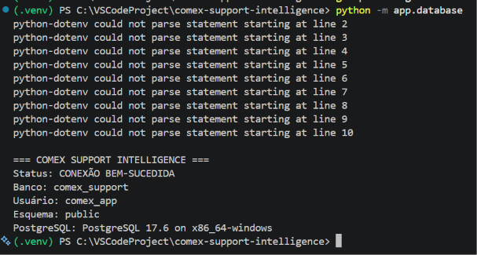

# Comex Support Intelligence

**A simulated technical support, data quality, and operational analytics platform for foreign trade operations.**

**Project status:** Day 1 completed — local development environment and PostgreSQL connectivity.

## Overview

Comex Support Intelligence is a portfolio project designed to explore how technical support, relational databases, data quality practices, and operational analytics can work together in a foreign trade environment.

The project uses fictional business scenarios involving shipments, commercial documents, data inconsistencies, and technical support requests.

Its long-term goal is to demonstrate practical problem-solving through a modular Python application supported by PostgreSQL.

> **Disclaimer:** This is an independent educational project. All planned business records are fictional. The project is not affiliated with any logistics provider, employer, or commercial organization.

## Problem Statement

Foreign trade operations depend on consistent shipment information, accurate documentation, and timely resolution of technical incidents.

Data inconsistencies and unresolved support requests can reduce operational visibility and make troubleshooting more difficult.

Comex Support Intelligence is designed to explore three related challenges:

1. Identifying and investigating inconsistent operational data.
2. Organizing technical support requests and their resolution history.
3. Monitoring operational indicators to support decision-making.

These capabilities are planned for future development stages and are not part of the current implementation.

## Current Implementation — Day 1

The first development milestone establishes the project's technical foundation.

**Implemented and locally validated:**

- Git repository and version control.
- Python 3.12 virtual environment.
- PostgreSQL 17 local database configuration.
- Dedicated database user with restricted administrative privileges.
- Database configuration through environment variables.
- Reusable Python database connection using Psycopg 3.
- SQL connectivity verification.
- Basic database error handling.
- Dependency version tracking.
- Git configuration to exclude local credentials.

**Verified locally:** the Python application connected to the `comex_support` database using the `comex_app` account and completed its connectivity test with exit code `0`.

No business tables, shipment records, ticket management features, or dashboards have been implemented yet.

## Technology Stack

| Technology | Purpose |
|---|---|
| Python 3.12 | Application development |
| PostgreSQL 17 | Relational database |
| Psycopg 3 | Python–PostgreSQL connectivity |
| python-dotenv | Environment configuration |
| Git | Version control |
| GitHub | Source code hosting |
| Visual Studio Code | Development environment |
| Windows 11 | Local development platform |

SQL, Pandas, Streamlit, and pytest are included in the development roadmap, but their planned application features are not yet implemented.

## Initial Architecture

The current application follows a simple modular structure:

```text
Local Environment
       |
       v
Python Application
       |
       v
app/database.py
       |
       v
Psycopg 3
       |
       v
PostgreSQL 17
       |
       v
comex_support
```

Database credentials are loaded from a local `.env` file and are not hardcoded in the Python source.

Future development will extend this foundation with business data models, repository functions, application services, and a user interface.

## Getting Started

### Prerequisites

Install the following tools:

- Python 3.12
- PostgreSQL 17
- Git
- Visual Studio Code (recommended)

The instructions below use Windows PowerShell.

### 1. Clone the repository

```powershell
git clone https://github.com/JGeovani/comex-support-intelligence.git
cd comex-support-intelligence
```

### 2. Create a Python virtual environment

```powershell
py -3.12 -m venv .venv
```

Activate the environment:

```powershell
.\.venv\Scripts\Activate.ps1
```

If PowerShell blocks script execution, use the following command for the current session:

```powershell
Set-ExecutionPolicy -Scope Process -ExecutionPolicy Bypass
```

Then activate the virtual environment again.

### 3. Install dependencies

```powershell
python -m pip install -r requirements.txt
```

### 4. Configure PostgreSQL

Start the PostgreSQL server and connect using an administrative account.

Create a dedicated application role and database:

```sql
CREATE ROLE comex_app
WITH LOGIN PASSWORD 'REPLACE_WITH_A_STRONG_LOCAL_PASSWORD';

CREATE DATABASE comex_support
OWNER comex_app;
```

Execute these statements separately if using a SQL client that wraps multiple statements in a transaction.

The application role should not receive superuser, database creation, or role management privileges.

### 5. Configure environment variables

Create a local `.env` file in the project root using `.env.example` as a reference.

```dotenv
DB_HOST=localhost
DB_PORT=5432
DB_NAME=comex_support
DB_USER=comex_app
DB_PASSWORD=YOUR_LOCAL_PASSWORD
```

Replace `YOUR_LOCAL_PASSWORD` with the password configured for the PostgreSQL application user.

Never commit the `.env` file or publish real database credentials.

### 6. Verify database connectivity

From the project root, run:

```powershell
python -m app.database
```

Expected output:

```text
=== COMEX SUPPORT INTELLIGENCE ===
Status: CONEXÃO BEM-SUCEDIDA
Banco: comex_support
Usuário: comex_app
Esquema: public
PostgreSQL: PostgreSQL 17.x
```

The exact PostgreSQL version may differ.

Check the process exit code in PowerShell:

```powershell
$LASTEXITCODE
```

A successful execution returns:

```text
0
```

This test verifies connectivity and executes a SQL query. It does not create or modify business records.

### Connection Test Evidence

The following screenshot demonstrates a successful
connection between Python and PostgreSQL.



## Repository Structure

```text
comex-support-intelligence/
├── app/
│   ├── __init__.py
│   └── database.py
├── .env.example
├── .gitignore
├── requirements.txt
└── README.md
```

Additional folders and files will be introduced as their respective components are implemented.

## Security Practices

The initial implementation adopts the following security measures:

- Database credentials are stored outside the source code.
- Local environment files are excluded through `.gitignore`.
- A dedicated PostgreSQL application account is used.
- Administrative database privileges are not required for the application.
- Database connections and cursors use context managers.
- Connection attempts have a defined timeout.
- The connectivity script reports a failure without printing database passwords.

These measures establish a basic local development security baseline. They do not constitute a complete production security architecture.

## Development Roadmap

| Day | Planned milestone | Status |
|---|---|---|
| 1 | Repository, environment, PostgreSQL connection | Completed |
| 2 | Relational schema, staging, fictional sample data | Planned |
| 3 | Data quality checks and investigation logic | Planned |
| 4 | Support tickets and status history | Planned |
| 5 | SLA indicators and operational dashboard | Planned |
| 6 | Automated tests and technical hardening | Planned |
| 7 | Final documentation, demonstration, and release | Planned |

### Planned Modules

**Data Quality & Investigation**

Detect and investigate data inconsistencies in fictional shipment and documentation records.

**Support Ticket Management**

Register, prioritize, update, and track simulated technical support requests.

**Support Analytics Dashboard**

Present operational indicators related to support activities, data quality, and service-level performance.

These modules are design objectives, not completed features.

## Engineering Principles

The project prioritizes:

- Reproducibility and clear documentation.
- Modular and maintainable Python code.
- Relational data integrity.
- Secure handling of configuration secrets.
- Traceability of technical decisions.
- Testable business rules.
- Incremental development with Git.

## Project Purpose

Comex Support Intelligence is intended to demonstrate practical competencies in technical support engineering, SQL, database troubleshooting, data quality, Python development, and operational problem-solving.

It is developed as an independent professional portfolio project using exclusively fictional scenarios.

## License

This project is licensed under the MIT License. See the `LICENSE` file for details.