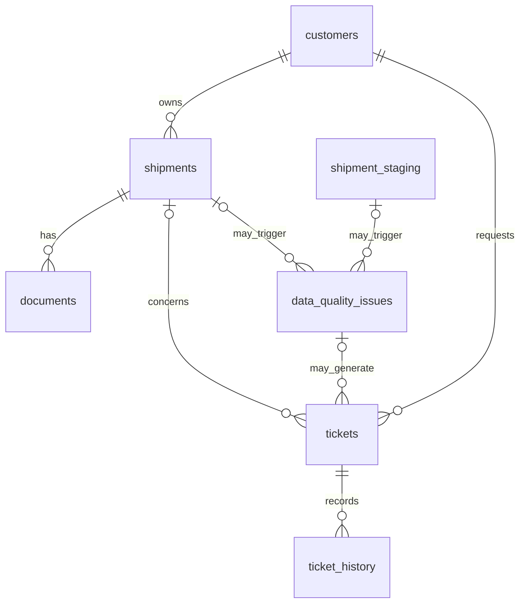

# Data Model — Comex Support Intelligence

**Status:** Conceptual and logical design (Day 2, Step 1)  
**Database target:** PostgreSQL 17  
**Scope:** Fictional foreign-trade technical support, data quality and operational analytics  
**Implementation:** Design only. No database tables or SQL scripts are created by this document.

## 1. Purpose and boundaries

The data model supports three planned modules:

1. **Data Quality & Investigation:** ingest raw shipment data, detect anomalies and retain evidence.
2. **Support Ticket Management:** track customer requests, priorities, statuses and transitions.
3. **Support Analytics Dashboard:** analyze support workload, data quality and service levels.

All customer, shipment and document information must be fictional. No external integrations are part of the MVP.

## 2. Conceptual entities

| Entity | Purpose |
|---|---|
| `customers` | Fictional customer organizations |
| `shipments` | Validated international shipments |
| `documents` | Commercial documents associated with shipments |
| `shipment_staging` | Raw import records, including invalid or duplicate values |
| `data_quality_issues` | Detected anomalies linked to a staging row and/or validated shipment |
| `tickets` | Technical support requests |
| `ticket_history` | Auditable ticket status transitions |

### Entity relationships

The optionality above refers to whether the child record must reference the parent. For example, a ticket requires a customer but may omit a shipment or issue reference. A quality issue must reference **at least one** of a staging row or a validated shipment.

## 3. Logical schema

Types below describe the intended PostgreSQL physical implementation. Primary-key values will use `BIGINT GENERATED BY DEFAULT AS IDENTITY` in the implementation step.

### 3.1 `customers`

| Column | Type | Constraints / meaning |
|---|---|---|
| `customer_id` | BIGINT | Primary key |
| `customer_name` | VARCHAR(150) | NOT NULL |
| `customer_code` | VARCHAR(30) | NOT NULL, UNIQUE |
| `contact_email` | VARCHAR(255) | Nullable; fictional contact |
| `created_at` | TIMESTAMPTZ | NOT NULL; default current timestamp |

**Rationale:** A surrogate identifier remains stable even when a business-facing customer code changes.

### 3.2 `shipments`

| Column | Type | Constraints / meaning |
|---|---|---|
| `shipment_id` | BIGINT | Primary key |
| `customer_id` | BIGINT | NOT NULL, FK → customers |
| `shipment_reference` | VARCHAR(50) | NOT NULL, UNIQUE |
| `origin_country` | CHAR(2) | NOT NULL; ISO-style two-letter country code |
| `destination_country` | CHAR(2) | NOT NULL; ISO-style two-letter country code |
| `departure_date` | DATE | NOT NULL |
| `arrival_date` | DATE | Nullable; must not precede departure when present |
| `status` | VARCHAR(30) | NOT NULL; controlled vocabulary |
| `created_at` | TIMESTAMPTZ | NOT NULL; default current timestamp |

**Allowed status values:** `PLANNED`, `IN_TRANSIT`, `ARRIVED`, `CANCELLED`.

**Rationale:** Validated shipments have unique references and coherent dates. Duplicate references and invalid dates remain in staging for investigation.

### 3.3 `documents`

| Column | Type | Constraints / meaning |
|---|---|---|
| `document_id` | BIGINT | Primary key |
| `shipment_id` | BIGINT | NOT NULL, FK → shipments |
| `document_type` | VARCHAR(30) | NOT NULL; controlled vocabulary |
| `document_number` | VARCHAR(80) | Nullable |
| `document_status` | VARCHAR(20) | NOT NULL; vocabulary to be finalized before implementation |
| `created_at` | TIMESTAMPTZ | NOT NULL; default current timestamp |

**Initial document types:** `COMMERCIAL_INVOICE`, `PACKING_LIST`, `BILL_OF_LADING`.

**Rationale:** One shipment can have multiple documents. Missing required documents are detected by cross-table quality queries rather than a row-level CHECK constraint.

### 3.4 `shipment_staging`

| Column | Type | Constraints / meaning |
|---|---|---|
| `staging_id` | BIGINT | Primary key |
| `source_row_number` | INTEGER | Source row number; nullable for non-file imports |
| `shipment_reference` | TEXT | Nullable; raw value |
| `customer_code` | TEXT | Nullable; raw value |
| `departure_date_raw` | TEXT | Nullable; raw value |
| `arrival_date_raw` | TEXT | Nullable; raw value |
| `status_raw` | TEXT | Nullable; raw value |
| `raw_payload` | JSONB | Original record; recommended NOT NULL |
| `loaded_at` | TIMESTAMPTZ | NOT NULL; default current timestamp |

**Rationale:** Raw fields use TEXT so malformed values are not rejected before validation. JSONB preserves additional original attributes. Staging must not enforce validated shipment rules.

### 3.5 `data_quality_issues`

| Column | Type | Constraints / meaning |
|---|---|---|
| `issue_id` | BIGINT | Primary key |
| `staging_id` | BIGINT | Nullable, FK → shipment_staging |
| `shipment_id` | BIGINT | Nullable, FK → shipments |
| `rule_code` | VARCHAR(50) | NOT NULL |
| `severity` | VARCHAR(10) | NOT NULL; controlled vocabulary |
| `description` | TEXT | NOT NULL |
| `detected_at` | TIMESTAMPTZ | NOT NULL; default current timestamp |
| `resolved_at` | TIMESTAMPTZ | Nullable |

**Planned rule codes:** `DUPLICATE_REFERENCE`, `INVALID_DATE_ORDER`, `MISSING_REQUIRED_FIELD`, `INVALID_STATUS`, `MISSING_REQUIRED_DOCUMENT`.

**Integrity decision:** At least one of `staging_id` and `shipment_id` must be non-null. Both may be present if the finding legitimately relates to both records. The precise severity vocabulary will be finalized with the SQL schema.

### 3.6 `tickets`

| Column | Type | Constraints / meaning |
|---|---|---|
| `ticket_id` | BIGINT | Primary key |
| `customer_id` | BIGINT | NOT NULL, FK → customers |
| `shipment_id` | BIGINT | Nullable, FK → shipments |
| `issue_id` | BIGINT | Nullable, FK → data_quality_issues |
| `title` | VARCHAR(200) | NOT NULL |
| `description` | TEXT | NOT NULL |
| `priority` | VARCHAR(2) | NOT NULL; P1–P4 |
| `status` | VARCHAR(20) | NOT NULL; controlled vocabulary |
| `created_at` | TIMESTAMPTZ | NOT NULL; default current timestamp |
| `resolved_at` | TIMESTAMPTZ | Nullable |

**Allowed priorities:** `P1`, `P2`, `P3`, `P4`.  
**Allowed statuses:** `OPEN`, `IN_ANALYSIS`, `RESOLVED`, `CLOSED`.

**Planned SLA targets (calendar hours):** P1 = 4, P2 = 8, P3 = 24, P4 = 72. SLA calculations are not implemented in this stage.

**Rationale:** A customer can request support without referencing a specific shipment or quality issue. The current status is stored on the ticket for operational queries.

**Consistency consideration:** When `shipment_id` is present, the referenced shipment should belong to `customer_id`. This cross-record invariant must be enforced or checked in the implementation design.

### 3.7 `ticket_history`

| Column | Type | Constraints / meaning |
|---|---|---|
| `history_id` | BIGINT | Primary key |
| `ticket_id` | BIGINT | NOT NULL, FK → tickets |
| `previous_status` | VARCHAR(20) | Nullable for initial entry |
| `new_status` | VARCHAR(20) | NOT NULL; ticket status vocabulary |
| `change_note` | TEXT | Nullable |
| `changed_at` | TIMESTAMPTZ | NOT NULL; default current timestamp |

**Rationale:** Ticket history preserves a trace of state changes. Future application logic must update the ticket and insert its history record in the **same database transaction**.

## 4. Relationship matrix

| Parent | Child | Cardinality | Child foreign key |
|---|---|---|---|
| customers | shipments | 1:N | shipments.customer_id (required) |
| customers | tickets | 1:N | tickets.customer_id (required) |
| shipments | documents | 1:N | documents.shipment_id (required) |
| shipments | tickets | 1:N | tickets.shipment_id (optional) |
| shipments | data_quality_issues | 1:N | data_quality_issues.shipment_id (optional) |
| shipment_staging | data_quality_issues | 1:N | data_quality_issues.staging_id (optional) |
| data_quality_issues | tickets | 1:N | tickets.issue_id (optional) |
| tickets | ticket_history | 1:N | ticket_history.ticket_id (required) |

## 5. Integrity and design principles

- Use surrogate BIGINT primary keys with identity generation.
- Use foreign keys for referential integrity.
- Apply UNIQUE to customer codes and validated shipment references.
- Apply NOT NULL to required attributes.
- Use CHECK constraints for enumerated values and arrival/departure date order.
- Use TIMESTAMPTZ for event timestamps; DATE for shipment dates.
- Do not automatically cascade-delete tickets, histories or quality evidence.
- Index foreign-key columns and common filtering columns where query patterns justify it.
- Use parameterized SQL in Python repositories in later steps.
- Keep malformed imports in staging; do not weaken validated-table constraints.
- Detect missing documents using relational quality checks rather than a single-table CHECK.

## 6. Illustrative fictional scenario

1. Customer `CLI-001` — **Atlântico Comércio Ltda.** — has a shipment `SHP-2026-001` from BR to US.
2. Two incoming source rows contain the same shipment reference.
3. Both raw rows are retained in `shipment_staging`.
4. A quality rule identifies `DUPLICATE_REFERENCE` and records an issue.
5. A P2 support ticket is opened for the fictional customer.
6. A transition from `OPEN` to `IN_ANALYSIS` is recorded in `ticket_history`.

This scenario illustrates intended relationships; it is not seeded into the database at this stage.

## 7. Open decisions before physical schema implementation

- Final allowed values for `documents.document_status` and `data_quality_issues.severity`.
- Whether and how to enforce ticket/customer/shipment consistency at database level.
- Whether `shipment_staging` needs a batch identifier for repeated imports.
- Whether to prevent duplicate unresolved findings for the same source record and rule.
- Whether to add additional checks for country-code formatting and timestamp chronology.

## 8. Next step (not yet implemented)

After reviewing and approving this document, translate the logical model into `database/schema.sql`, then separately prepare fictional seed/staging data. No SQL migration, table creation, or sample-data loading is performed by this documentation commit.
