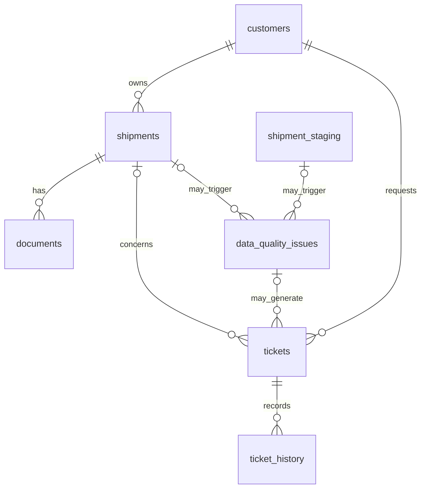

# Data Model — Comex Support Intelligence

**Status:** Approved conceptual and logical design (Day 2, Step 1)  
**Database target:** PostgreSQL 17  
**Scope:** Fictional foreign-trade technical support, data quality and operational analytics  
**Implementation:** Design only. No database tables or SQL scripts are created by this document.

## 1. Purpose and boundaries

The data model supports three planned modules:

1. **Data Quality & Investigation:** ingest raw shipment data, detect anomalies and retain evidence.
2. **Support Ticket Management:** track customer requests, priorities, statuses and transitions.
3. **Support Analytics Dashboard:** analyze support workload, data quality and service levels.

All customer, shipment and document information must be fictional. No external integrations are part of the MVP.

## 2. Conceptual entities

| Entity | Purpose |
|---|---|
| `customers` | Fictional customer organizations |
| `shipments` | Validated international shipments |
| `documents` | Commercial documents associated with shipments |
| `shipment_staging` | Raw import records, including invalid or duplicate values |
| `data_quality_issues` | Detected anomalies linked to a staging row and/or validated shipment |
| `tickets` | Technical support requests |
| `ticket_history` | Auditable ticket status transitions |

### Entity relationships

The optionality above refers to whether the child record must reference the parent. For example, a ticket requires a customer but may omit a shipment or issue reference. A quality issue must reference **at least one** of a staging row or a validated shipment.

## 3. Logical schema

Types below describe the intended PostgreSQL physical implementation. Primary-key values will use `BIGINT GENERATED BY DEFAULT AS IDENTITY` in the implementation step.

### 3.1 `customers`

| Column | Type | Constraints / meaning |
|---|---|---|
| `customer_id` | BIGINT | Primary key |
| `customer_name` | VARCHAR(150) | NOT NULL |
| `customer_code` | VARCHAR(30) | NOT NULL, UNIQUE |
| `contact_email` | VARCHAR(255) | Nullable; fictional contact |
| `created_at` | TIMESTAMPTZ | NOT NULL; default current timestamp |

**Rationale:** A surrogate identifier remains stable even when a business-facing customer code changes.

### 3.2 `shipments`

| Column | Type | Constraints / meaning |
|---|---|---|
| `shipment_id` | BIGINT | Primary key |
| `customer_id` | BIGINT | NOT NULL, FK → customers |
| `shipment_reference` | VARCHAR(50) | NOT NULL, UNIQUE |
| `origin_country` | CHAR(2) | NOT NULL; ISO-style two-letter country code |
| `destination_country` | CHAR(2) | NOT NULL; ISO-style two-letter country code |
| `departure_date` | DATE | NOT NULL |
| `arrival_date` | DATE | Nullable; must not precede departure when present |
| `status` | VARCHAR(30) | NOT NULL; controlled vocabulary |
| `created_at` | TIMESTAMPTZ | NOT NULL; default current timestamp |

**Allowed status values:** `PLANNED`, `IN_TRANSIT`, `ARRIVED`, `CANCELLED`.

**Rationale:** Validated shipments have unique references and coherent dates. Duplicate references and invalid dates remain in staging for investigation.

### 3.3 `documents`

| Column | Type | Constraints / meaning |
|---|---|---|
| `document_id` | BIGINT | Primary key |
| `shipment_id` | BIGINT | NOT NULL, FK → shipments |
| `document_type` | VARCHAR(30) | NOT NULL; controlled vocabulary |
| `document_number` | VARCHAR(80) | Nullable |
| `document_status` | VARCHAR(20) | NOT NULL; PENDING, RECEIVED, VALIDATED, REJECTED |
| `created_at` | TIMESTAMPTZ | NOT NULL; default current timestamp |

**Allowed document statuses:** `PENDING`, `RECEIVED`, `VALIDATED`, `REJECTED`.

**Initial document types:** `COMMERCIAL_INVOICE`, `PACKING_LIST`, `BILL_OF_LADING`.

**Rationale:** One shipment can have multiple documents. Missing required documents are detected by cross-table quality queries rather than a row-level CHECK constraint.

### 3.4 `shipment_staging`

| Column | Type | Constraints / meaning |
|---|---|---|
| `staging_id` | BIGINT | Primary key |
| `batch_id` | UUID | NOT NULL; shared by all rows of one import |
| `source_file` | TEXT | Nullable for non-file imports; source file name |
| `source_row_number` | INTEGER | Positive when present; nullable for non-file imports |
| `shipment_reference` | TEXT | Nullable; raw value |
| `customer_code` | TEXT | Nullable; raw value |
| `departure_date_raw` | TEXT | Nullable; raw value |
| `arrival_date_raw` | TEXT | Nullable; raw value |
| `status_raw` | TEXT | Nullable; raw value |
| `raw_payload` | JSONB | Original record; NOT NULL |
| `loaded_at` | TIMESTAMPTZ | NOT NULL; default current timestamp |

**Rationale:** Raw fields use TEXT so malformed values are not rejected before validation. JSONB preserves additional original attributes. Staging must not enforce validated shipment rules.

### 3.5 `data_quality_issues`

| Column | Type | Constraints / meaning |
|---|---|---|
| `issue_id` | BIGINT | Primary key |
| `staging_id` | BIGINT | Nullable, FK → shipment_staging |
| `shipment_id` | BIGINT | Nullable, FK → shipments |
| `rule_code` | VARCHAR(50) | NOT NULL |
| `severity` | VARCHAR(10) | NOT NULL; CRITICAL, HIGH, MEDIUM, LOW |
| `affected_field` | VARCHAR(80) | Nullable; field or document type affected by the rule |
| `description` | TEXT | NOT NULL |
| `detected_at` | TIMESTAMPTZ | NOT NULL; default current timestamp |
| `resolved_at` | TIMESTAMPTZ | Nullable |

**Planned rule codes:** `DUPLICATE_REFERENCE`, `INVALID_DATE_ORDER`, `MISSING_REQUIRED_FIELD`, `INVALID_STATUS`, `MISSING_REQUIRED_DOCUMENT`.

**Integrity decision:** At least one of `staging_id` and `shipment_id` must be non-null. Both may be present if the finding legitimately relates to both records. Severity describes data impact, not ticket urgency. Use `CRITICAL`, `HIGH`, `MEDIUM`, and `LOW`.

### 3.6 `tickets`

| Column | Type | Constraints / meaning |
|---|---|---|
| `ticket_id` | BIGINT | Primary key |
| `customer_id` | BIGINT | NOT NULL, FK → customers |
| `shipment_id` | BIGINT | Nullable, FK → shipments |
| `issue_id` | BIGINT | Nullable, FK → data_quality_issues |
| `title` | VARCHAR(200) | NOT NULL |
| `description` | TEXT | NOT NULL |
| `priority` | VARCHAR(2) | NOT NULL; P1–P4 |
| `status` | VARCHAR(20) | NOT NULL; controlled vocabulary |
| `created_at` | TIMESTAMPTZ | NOT NULL; default current timestamp |
| `resolved_at` | TIMESTAMPTZ | Nullable |

**Allowed priorities:** `P1`, `P2`, `P3`, `P4`.  
**Allowed statuses:** `OPEN`, `IN_ANALYSIS`, `RESOLVED`, `CLOSED`.

**Planned SLA targets (calendar hours):** P1 = 4, P2 = 8, P3 = 24, P4 = 72. SLA calculations are not implemented in this stage.

**Rationale:** A customer can request support without referencing a specific shipment or quality issue. The current status is stored on the ticket for operational queries.

**Consistency consideration:** When `shipment_id` is present, the referenced shipment should belong to `customer_id`. Enforce this invariant with a composite foreign key from tickets (shipment_id, customer_id) to a unique pair in shipments. The customer foreign key remains mandatory even when shipment_id is null. The Python service must additionally validate issue/shipment/customer consistency, including the staging customer code when available; unresolved ownership must not be silently attributed to another customer.

### 3.7 `ticket_history`

| Column | Type | Constraints / meaning |
|---|---|---|
| `history_id` | BIGINT | Primary key |
| `ticket_id` | BIGINT | NOT NULL, FK → tickets |
| `previous_status` | VARCHAR(20) | Nullable for initial entry |
| `new_status` | VARCHAR(20) | NOT NULL; ticket status vocabulary |
| `change_note` | TEXT | Nullable |
| `changed_at` | TIMESTAMPTZ | NOT NULL; default current timestamp |
| `changed_by` | VARCHAR(100) | NOT NULL; nonblank simulated actor, not an authenticated identity |

**Rationale:** Ticket history preserves a trace of state changes. Future application logic must update the ticket and insert its history record in the **same database transaction**.

## 4. Relationship matrix

| Parent | Child | Cardinality | Child foreign key |
|---|---|---|---|
| customers | shipments | 1:N | shipments.customer_id (required) |
| customers | tickets | 1:N | tickets.customer_id (required) |
| shipments | documents | 1:N | documents.shipment_id (required) |
| shipments | tickets | 1:N | tickets.shipment_id (optional) |
| shipments | data_quality_issues | 1:N | data_quality_issues.shipment_id (optional) |
| shipment_staging | data_quality_issues | 1:N | data_quality_issues.staging_id (optional) |
| data_quality_issues | tickets | 1:N | tickets.issue_id (optional) |
| tickets | ticket_history | 1:N | ticket_history.ticket_id (required) |

## 5. Integrity and design principles

- Use surrogate BIGINT primary keys with identity generation.
- Use foreign keys for referential integrity.
- Apply UNIQUE to customer codes and validated shipment references.
- Apply NOT NULL to required attributes.
- Use CHECK constraints for enumerated values and arrival/departure date order.
- Use TIMESTAMPTZ for event timestamps; DATE for shipment dates.
- Do not automatically cascade-delete tickets, histories or quality evidence.
- Index foreign-key columns and common filtering columns where query patterns justify it.
- Use parameterized SQL in Python repositories in later steps.
- Keep malformed imports in staging; do not weaken validated-table constraints.
- Detect missing documents using relational quality checks rather than a single-table CHECK.

## 6. Illustrative fictional scenario

1. Customer `CLI-001` — **Atlântico Comércio Ltda.** — has a shipment `SHP-2026-001` from BR to US.
2. Two incoming source rows contain the same shipment reference.
3. Both raw rows are retained in `shipment_staging`.
4. A quality rule identifies `DUPLICATE_REFERENCE` and records an issue.
5. A P2 support ticket is opened for the fictional customer.
6. A transition from `OPEN` to `IN_ANALYSIS` is recorded in `ticket_history`.

This scenario illustrates intended relationships; it is not seeded into the database at this stage.

## 7. Approved architecture decisions

### 7.1 Controlled vocabularies

Use VARCHAR with CHECK constraints for shipment status, document type and status, issue severity, ticket priority and status, and history status values. Document status: PENDING (awaiting receipt), RECEIVED, VALIDATED, REJECTED. Issue severity: CRITICAL, HIGH, MEDIUM, LOW, in descending impact. A missing mandatory document or a pending mandatory document can trigger a quality finding under the simulated business rule; document type identifies the affected item. Severity and ticket priority are independent concepts.

### 7.2 Customer, shipment and ticket consistency

Keep the mandatory customer FK on tickets and use a composite FK (shipment_id, customer_id) referencing a unique pair on shipments. Optional shipment references remain nullable. The service layer must validate the issue association against the ticket customer and shipment when ownership is known. No authentication or additional user table is introduced.

### 7.3 Import batch traceability

Generate one UUID per import and reuse it for every staging row in that batch. Store the source file name when applicable and a positive source row number when available. Detect duplicate references within a batch; repeated references across batches are not automatically duplicate rows within one import, but must be evaluated against validated shipment references. Do not create an eighth table for batches.

### 7.4 Idempotent quality findings

Use partial unique indexes for unresolved findings (resolved_at is null). Maintain one active finding per staging row, rule code and affected field when staging_id is present; otherwise use shipment_id, rule code and affected field. Treat null affected fields as equal (PostgreSQL 17 supports NULLS NOT DISTINCT). When both origins are present, staging is the canonical deduplication origin; shipment is contextual. Use stable affected_field identifiers, including document type where appropriate. A resolved finding may recur as a new finding. Repeated checks must not inflate active issue counts.

### 7.5 Format and chronology

Require nonblank customer name/code, shipment reference, ticket title/description and history actor. Country codes must contain exactly two uppercase ASCII letters; this validates format, not ISO membership. Arrival date must be on or after departure date when present. Ticket resolution must be on or after creation; issue resolution must be on or after detection. Source row numbers must be positive when supplied. Raw staging values remain permissive.

### 7.6 History actor and traceability

Record changed_by for each history entry (e.g., analyst_01 or system). It is a simulated actor label, not proof of authentication. Record the initial entry with null previous_status and OPEN as new_status. Preserve history and update current status and history atomically in the application transaction.

### 7.7 Ticket lifecycle

The MVP permits only OPEN → IN_ANALYSIS → RESOLVED → CLOSED. No reopening or skipped transitions. The application service validates transitions and records history in the same transaction. resolved_at must be null for OPEN and IN_ANALYSIS and non-null for RESOLVED and CLOSED. Set it at resolution and preserve it at administrative closure. Priority remains fixed during the ticket lifecycle. Row-level constraints enforce status/timestamp consistency; transition and history consistency are service-layer responsibilities.

### 7.8 Resolution SLA

| Priority | Target (elapsed calendar hours) |
|---|---:|
| P1 | 4 |
| P2 | 8 |
| P3 | 24 |
| P4 | 72 |

Start at created_at; stop at resolved_at, or use the current time for unresolved tickets. Resolution at the deadline meets SLA; elapsed time greater than the target breaches it. Administrative closure does not reset the clock. Derive elapsed time and SLA indicators rather than storing a changing duration. No business-hours calendar or priority changes in the MVP.

## 8. Approved model summary

| Entity | Columns |
|---|---:|
| customers | 5 |
| shipments | 9 |
| documents | 6 |
| shipment_staging | 11 |
| data_quality_issues | 9 |
| tickets | 10 |
| ticket_history | 7 |
| **Total** | **57** |

All eight architecture decisions were approved. The seven-entity relationship diagram remains unchanged because the additional fields and constraints do not introduce new entities or relationships.

## 9. Next step (not yet implemented)

Translate the approved logical model into database/schema.sql in Day 2, Step 2. Prepare fictional seed/staging data separately. This documentation revision does not create tables, write a SQL schema file, or execute SQL.
